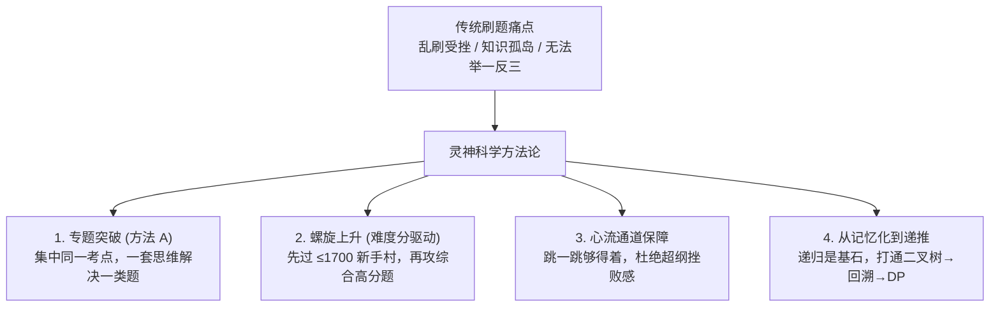
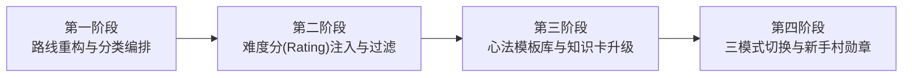

# 灵神《如何科学刷题？》体系化重构规划方案

> 本规划依据力扣（LeetCode）知名算法竞赛大牛 **灵茶山艾府（EndlessCheng / 灵神）** 的经典指南 [《如何科学刷题？》](https://leetcode.cn/discuss/post/3141566/ru-he-ke-xue-shua-ti-by-endlesscheng-q3yd/) 制定。
> 核心目标是将当前的「算法训练台」全面升级为一套**符合认知心理学、心流通道设计、以难度分（Rating）为导向、支持专题螺旋上升**的现代化科学刷题平台。

---

## 一、 灵神刷题方法论核心解析与映射

灵神在原帖中指出了传统刷题的三大痛点：**乱刷随机题容易受挫、死磕大厂标签导致考点零散、死记硬背题解换个马甲就不会**。

为此，灵神提出了三大核心原则：

---

## 二、 知识体系与模块重构：新手村七阶段路线图

当前平台的 14 个模块是按传统数据结构教材罗列的（如链表放第一）。而灵神的推荐路线更符合**从直观到抽象、从单指针到双指针再到递归与动态规划**的认知规律。

我们建议将平台主线划分为 **「通关新手村（Stage 1 ~ 7）」** 与 **「高阶进阶殿堂（Stage 8+）」**：

### 阶段一：新手村主线（难度分 $\le 1700$，建立正反馈）

| 阶段 | 模块名 | 核心考点与套路 | 为什么这个顺序？ | 灵神配套心法/视频 |
| :--- | :--- | :--- | :--- | :--- |
| **Stage 0** | **指针与基础操作** | 链表反转、双指针交汇、基本容器（vector/string） | 编程基本功，消除对指针的恐惧 | 编程入门基石 |
| **Stage 1** | **滑动窗口与双指针** | 定长窗口、不定长求最长/最短、双序列双指针 | 直观易懂，立竿见影建立「区间维护」思维 | 《基础算法精讲 01-03》 |
| **Stage 2** | **二分查找与二分答案** | 红蓝染色法、左右边界、最大化最小值、求第 K 小 | 掌握**二分本质是单调性与二段性**，非单纯有序数组 | 《基础算法精讲 04-06》 |
| **Stage 3** | **常用基础数据结构** | 前缀和（子数组和）、单调栈（下一个更大）、堆（TopK） | 解决暴力超时利器，构建「空间换时间」的工具箱 | 掌握差分与前缀和互逆 |
| **Stage 4** | **二叉树 DFS** | 深入理解递归：树的最大深度、路径和、最近公共祖先 | **理解递归的本质（归去来兮）**，为回溯和DP奠基 | 《基础算法精讲 09-12》 |
| **Stage 5** | **网格图搜索 (DFS/BFS)** | 岛屿数量、腐烂的橘子、迷宫最短路 | 将二叉树的多叉形态扩展到二维矩阵，理解多源BFS | 掌握网格图方向数组与访问标记 |
| **Stage 6** | **回溯算法** | 选/不选视角、枚举选哪个视角、排列组合与剪枝 | **回溯就是有撤销操作的树形遍历** | 《基础算法精讲 13-16》 |
| **Stage 7** | **动态规划入门（破除DP恐惧）** | 记忆化搜索入门、0-1背包、最长上升子序列、打家劫舍 | **DP 的本质就是带备忘录的回溯（化搜索为递推）** | 《基础算法精讲 17-20》 |

> [!IMPORTANT]
> **通关新手村标志**：刷完以上 7 个阶段中难度分 $\le 1700$ 的基础题后，学员已掌握 80% 的日常面试高频套路，代码实现能力和递归抽象思维已牢固建立。

---

### 阶段二：进阶进阶殿堂（难度分 $1700 \sim 2200+$）

在通关新手村后，开放高阶专项：
1. **图论高级**：拓扑排序（课程表）、Dijkstra 最短路、最小生成树
2. **高级数据结构**：并查集（连通分量）、Trie 字典树（前缀匹配）、树状数组/线段树
3. **动态规划进阶**：状态机 DP（股票系列）、区间 DP、状压 DP、数位 DP、树形 DP
4. **贪心与思维**：区间调度、反悔贪心、中位数贪心

---

## 三、 平台功能与交互层面的落地升级规划

为契合《如何科学刷题？》，平台交互与数据结构需进行 5 项重大升级：

### 1. 题目难度分（Contest Rating）体系全面接入
- **摒弃模糊的“星级”或保留为双轨制**：为每道题增加真实或官方推导的 **LeetCode Contest Rating（难度分，如 1350、1520、1680、1910）**。
- **一键切换「新手村模式（$\le 1700$）」**：
  - 点击工具栏的 `新手村 (≤1700)` 过滤器，界面立即隐藏综合性极强的高难度复合题，让新手在不被打击自信心的情况下走完一遍全题单。
  - 达到新手村 100% 达成率后，自动触发「新手村毕业」荣誉勋章！

### 2. 三种科学刷题模式（方法 A / B / C）自由切换
- **模式 A：专题突破模式（默认推荐）**
  - 按 7 大阶段知识树逐个专题推进，题目按难度分升序排列（从 1200 分一直做到 1900 分），实现螺旋上升。
- **模式 B：盲盒随机训练模式（去标签化）**
  - 适用于通关新手村后的学员：**隐藏题目标签与所属模块**，随机抽题。训练“一眼看出该用二分还是滑窗”的比赛/面试实战嗅觉。
- **模式 C：经典 Hot 100 突击模式**
  - 标记出题目中属于 LeetCode Hot 100 / 面试 150 题的标签，支持面试前两周快速过筛。

### 3. 灵神解题心法与经典模板库（融入知识卡片）
在平台的「知识卡片」和「解题思路」中，直接植入灵神最经典的思维模板：
- **二分查找**：放弃易出错的 `while (left <= right)` 各种端点讨论，主推灵神的 **「红蓝染色法（区间划分）」**：
  - 确定好 `isBlue(mid)` 条件，红区往右缩，蓝区往左缩，最终根据题目要求返回 `left` 还是 `right`。
- **滑动窗口**：
  - 定长滑窗：`右进 -> 下标 >= k - 1 时更新答案 -> 左出`
  - 不定长滑窗：`右进 -> while (不满足约束) 左出 -> 更新答案`
- **二叉树与回溯**：
  - 递归三问：子问题是什么？当前节点做什么？返回什么给父节点？
  - 回溯双重视角：视角一（输入角度：选还是不选？）；视角二（答案角度：当前位置选哪个？）。
- **动态规划**：
  - 坚持 **「回溯思考 -> 加记忆化 -> 1:1 翻译成递推数组」** 的三步走教学法，彻底消除初学者对状态转移方程凭空出现的恐惧。

### 4. 学习打卡战报全面融入灵神体系
- 分享卡片（`share.js`）显示当前所处的刷题阶段（如「新手村 · 滑动窗口 Stage 1」）、已掌握的难度分区间、已通关的专题数量。

---

## 四、 实施落地分阶段路线

1. **第一阶段：目录结构与阶段重排**
   - 调整 `data/modules.js`，按灵神「新手村 7 阶段 + 高阶专题」重排顺序。
   - 题目重新归类到对应阶段。
2. **第二阶段：难度分（Rating）数据补全与筛选**
   - 在 `data/problems.js` 中为每道题加入 `rating` 属性（例如 1200~2100）。
   - 在 `js/practice.js` 中新增 Rating 范围过滤与「新手村 ≤1700」过滤。
3. **第三阶段：灵神核心算法模板与思想注入**
   - 更新 `data/knowledge.js`，补全红蓝二分、滑窗标准套路、回溯双视角、记忆化到DP的递推演化。
4. **第四阶段：交互完善与构建发布**
   - 更新前台 UI 增加模式选择，执行 `python build.py` 重新生成打包文件。

---

## 五、 预期效果对比

| 维度 | 改造前（传统教材型） | 改造后（灵神科学刷题型） |
| :--- | :--- | :--- |
| **模块顺序** | 链表 -> 树 -> 图 -> 堆 -> DP（无认知递进） | **滑窗 -> 二分 -> 结构 -> 树 -> 网格 -> 回溯 -> DP**（层层铺垫） |
| **难度刻画** | ★ / ★★ / ★★★（过于笼统，无法感知梯度） | **精细化 Rating 难度分（1200 ~ 2200+）** |
| **挫败感控制** | 容易随机撞上难题产生放弃感 | **≤1700 新手村护航，心流通道全开** |
| **思维框架** | 就题论题，单题题解 | **掌握通用母题与解题心法（红蓝染色、回溯双视角等）** |
| **训练模式** | 仅按模块点选题 | **专题突破 / 盲盒实战 / Hot突击 三模式自由切换** |
